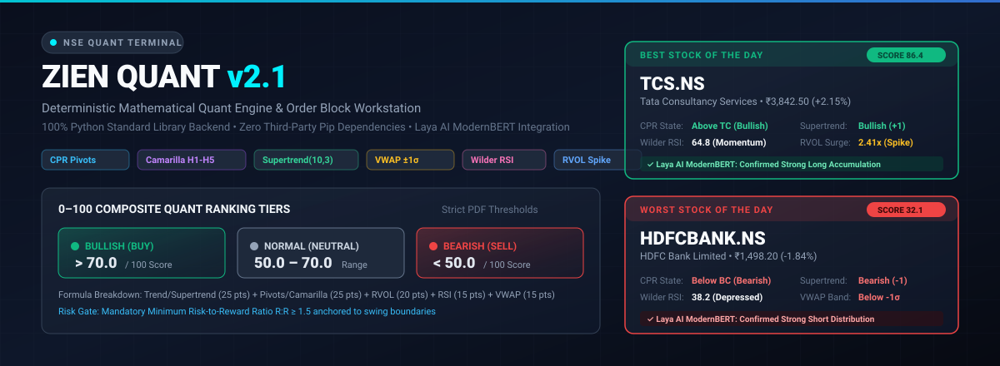
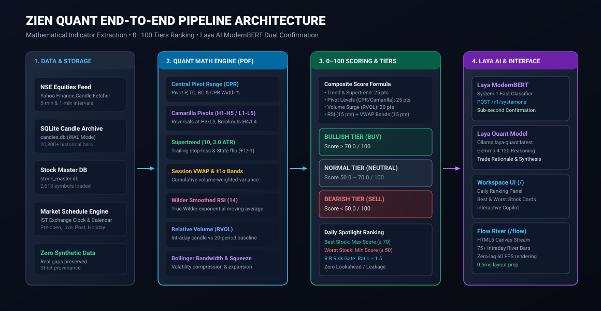
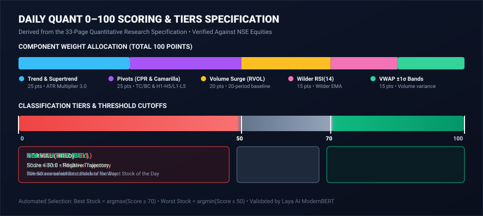
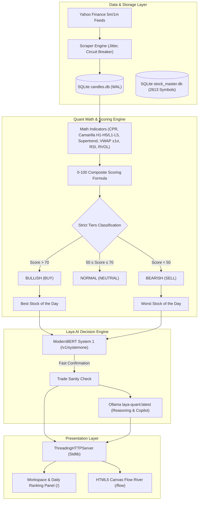

# Zien Quant - Order Block Terminal

The supplied November update archives have been reviewed and the company earnings
pipeline is integrated at **`http://127.0.0.1:8765/company-research`**. It includes
the imported chart explorer, collectors, causal features and model bridge, with
unvalidated forecasts kept unavailable. See the [integration review and commands](docs/UPDATES_INTEGRATION_2026-11-16.md).

[](https://github.com/ekanth14/zien-quant/actions)


<p align="center">
  
</p>

**Zien Quant** is a deterministic quantitative trading terminal and order block analysis workstation for Indian cash equities (National Stock Exchange - NSE). Built from the ground up on a **100% Python Standard Library backend** with zero third-party pip dependencies, it delivers deterministic technical order block detection, canvas-rendered intraday flow rivers, automated risk-to-reward gating, and local AI trade reasoning powered by Ollama and Laya AI ModernBERT System 1. Data is sourced from Yahoo Finance chart candles; the terminal is a single-owner administrative system and does not rely on direct exchange feeds, Level 2/3 order flow, or institutional participant tracking.

**Version 2.1.0** introduces verified previous close resolution, 1-minute candle matrix streaming with 5-second polling, canvas-rendered trajectory matrix fields, and explicit design preview labeling. The homepage provides the responsive workspace with market overview, stock scanner, watchlist, stock inspection, owner console, and Laya assistant. The Flow River remains available at `/flow`. See the [frontend version notes](docs/FRONTEND_V2.md).

The daily formula panel compares the strongest and weakest observed stocks using closed five-minute OHLCV indicators from the supplied research PDF: Central Pivot Range (CPR), Camarilla ($H_1..H_5, L_1..L_5$), Supertrend (10, 3.0), Session VWAP & $\pm 1\sigma$ bands, Wilder RSI(14), Relative Volume (RVOL), and Bollinger Bandwidth. Stocks are scored out of 100 with strict classification tiers: **Bullish** ($>70$), **Normal** ($50–70$), and **Bearish** ($<50$), with **Best Stock of the Day** and **Worst Stock of the Day** deterministic selection confirmed by Laya AI ModernBERT System 1 (`/v1/systemone`). See the [PDF analysis and local model setup](docs/PDF_FORMULA_ANALYSIS.md).

---

## Visual Tour

### Quantitative Decision Architecture & Pipeline
<p align="center">
  
</p>

### 0–100 Scoring Formula & Classification Tiers
<p align="center">
  
</p>

### Intraday Workstation & Flow River
| Intraday Flow River Terminal | Pinned Setup & Candlestick Profile |
|:---:|:---:|
|  |  |

| Responsive Tablet & Workspace View |
|:---:|
|  |

---

## Core Capabilities

- **0–100 Composite Quant Scoring Engine**: Rigorous, multi-factor indicator normalization incorporating Supertrend (25%), CPR & Camarilla pivots (25%), Relative Volume RVOL (20%), Wilder Smoothed RSI (15%), and Session VWAP $\pm 1\sigma$ bands (15%).
- **Strict Classification Tiers**:
  - **BULLISH (BUY)**: Composite Score $> 70.0$ / 100
  - **NORMAL (NEUTRAL)**: Composite Score $50.0 – 70.0$ / 100
  - **BEARISH (SELL)**: Composite Score $< 50.0$ / 100
- **Automated Best & Worst Stock of the Day**: Deterministic identification of the single strongest accumulation candidate ($\max(\text{score} \ge 70)$) and weakest distribution candidate ($\min(\text{score} \le 50)$).
- **Dual-Model Laya AI Decision System**: Fast ModernBERT System 1 classifier (`/v1/systemone`) provides sub-second confirmation and sentiment sanity checks, backed by Ollama `laya-quant:latest` / `gemma4:12b` for deep quantitative trade reasoning.
- **Intraday Flow River**: High-framerate HTML5 Canvas stream visualizing price and volume momentum across 75+ intraday candle bars for the liquid NSE universe.
- **Setup Cards with Strict R:R Gating**: Intraday trade opportunities with mathematical validation. Setups require a mandatory **Risk:Reward ratio $\ge 1.5$** anchored to verified swing pivots; invalid or low-expectancy structures are automatically discarded.
- **Zero Synthetic Data Guarantee**: No fake candles, synthetic price randomizers, or invented levels. Missing or off-market data is honestly reflected via dedicated session states.
- **Previous Session Playback Engine**: Automatically computes and replays real persisted Yahoo Finance candle data from the most recent completed market session when the exchange is closed or upstream feeds are down, with built-in holiday awareness.
- **In-place Historical Chart**: Opens from the existing dashboard chart in a resizable side panel. It uses FYERS historical candles for NSE equities and indices, with 1D, 5D, 1M, 6M, YTD and custom ranges, synchronized intraday candles, volume when supplied, and clear historical-data timestamps. It is read-only and does not place orders.
- **Laya AI Commentary**: Optional local intelligence integration with Ollama (`gemma4:12b`). Features strict regex numerical bounds validation against price discrepancies and a deterministic rules engine fallback.
- **Resilient Upstream Scraper**: Multi-tiered fetcher with exponential backoff, randomized jitter, and an automatic circuit breaker tripping after consecutive upstream errors.
- **Hardened Single-Owner Security**: Multi-factor authentication (TOTP), PBKDF2 HMAC-SHA256 password hashing, anti-CSRF token verification, session tracking, and sliding-window rate limiters.

---

## Prerequisites

| Requirement | Specification | Notes |
|:---|:---|:---|
| **Operating System** | Windows 10/11, Ubuntu 20.04+, Debian 11+, macOS 12+ | Cross-platform compatible |
| **Python** | Python 3.12 or newer | Standard Library only; no `pip install` required |
| **RAM** | 2 GB minimum (16 GB if running local Ollama LLM) | Lightweight stdlib memory footprint |
| **Disk Space** | 250 MB free disk space | SQLite database with WAL mode |
| **Optional LLM** | Ollama with `gemma4:12b` | Optional; terminal operates fully with rules engine |

---

## Quickstart

Run three commands in your terminal to start Zien Quant:

### Linux / macOS
```bash
git clone https://github.com/ekanth14/zien-quant.git && cd zien-quant
bash scripts/setup.sh
python manage.py init-owner
bash scripts/run.sh
```

### Windows (PowerShell)
```powershell
git clone https://github.com/ekanth14/zien-quant.git; cd zien-quant
.\scripts\setup.ps1
python manage.py init-owner
.\scripts\run.ps1
```

Open your browser at: **`http://127.0.0.1:8765/`**

The homepage opens the new reference-inspired workspace; `/index.html` opens the same interface. Open **`http://127.0.0.1:8765/flow`** for the existing Flow River. No frontend build step or Node.js installation is required to run either interface. If no live or archived observations are available, the workspace shows the data-unavailable state instead of generated sample prices.

---

## Step-by-Step Installation Guide

### Step 1: Clone Repository
```bash
git clone https://github.com/ekanth14/zien-quant.git
cd zien-quant
```

### Step 2: Run Setup Script
The automated setup script creates runtime database directories (`work/runtime/`, `work/backups/`), instantiates configuration from `.env.example`, runs SQLite database schema migrations, seeds the top-100 liquid stock master catalog, and tests Ollama status.

- **Linux / macOS**: `bash scripts/setup.sh`
- **Windows**: `.\scripts\setup.ps1`

### Step 3: Initialize Owner Account
Zien Quant operates on a single-owner administrative security model. Initialize your administrative credentials:
```bash
python manage.py init-owner --email "owner@example.com" --password "YourStrongPassword123!"
```
*The command outputs your secret TOTP key. Add this key to your authenticator app (Google Authenticator, Authy, etc.).*

### Step 4: (Optional) Setup Ollama for Local AI Synthesis
If you want deep qualitative reasoning alongside deterministic signals:
1. Install [Ollama](https://ollama.ai).
2. Pull or build the Laya AI models:
   ```bash
   # System 1: Ultra-fast 421M parameter trade bias decision model (~200ms)
   ollama pull laya

   # System 2: Deep qualitative quantitative reasoning assistant
   ollama pull gemma4:12b
   # Or create the specialized assistant from Modelfile:
   ollama create laya-ai -f Modelfile
   ```
3. Ensure the daemon is running on `http://127.0.0.1:11434`.

*If Ollama is not installed or unreachable, Zien Quant operates seamlessly using its internal 0ms deterministic quantitative rules engine.*

### Step 5: Start Server
```bash
python server.py --host 127.0.0.1 --port 8765
```

### Step 6: Verify System Health
Run the terminal doctor check:
```bash
python manage.py doctor
```

---

## Terminal User Guide

### 1. The Flow River Visualization
The top panel renders the **Flow River**, an animated intraday price & volume flow display.
- **Horizontal Axis**: 75 rolling 5-minute candles across the trading day (09:15 to 15:30 IST).
- **Vertical Spread**: Percentage deviation from session open (-3% to +3%).
- **Color Coding**: Emerald green streams denote bullish momentum; magenta/amber streams denote bearish pressure or consolidation.
- **Interactive Tooltips**: Hover over any stock stream to inspect current RSI, Relative Volume (RVOL), VWAP distance, and composite score. Click to pin the inspector card.

### 2. The 4 Funnel Stages
All tracked equities pass through a continuous mathematical pipeline:
1. **Movers**: Intraday price change threshold filter ($|\Delta\%| \ge 1.0\%$).
2. **Volume**: Relative Volume expansion ($RVOL \ge 1.2$).
3. **Pressure**: Directional algorithmic composite score ($\ge 60$ for bullish, $\le 40$ for bearish).
4. **Setups**: Technical setup qualification requiring execution grade (A+, A, B) and risk-to-reward ratio gating ($R:R \ge 1.5$).

### 3. Setup Cards & R:R Gating
Actionable trade setups are rendered as cards in the lower console:
- **Mandatory R:R Gate**: Every trade setup requires a minimum calculated Risk:Reward ratio of **1.5**.
- **Stop Loss & Target Calculation**: Stops are anchored beyond technical order block invalidation thresholds; targets are set at opposing liquidity boundaries. Setups failing the R:R threshold or missing verified candle levels are suppressed.
- **Conviction Score**: Ranked 0 to 100 based on multi-timeframe trend alignment, VWAP positioning, and volume confirmation.

### 4. Session States & Honest Transparency
- **`LIVE` (Green Badge)**: Market is open (Monday–Friday, 09:15–15:30 IST), and live Yahoo Finance chart candles are streaming.
- **`CLOSED` (Slate Badge)**: Market is closed (weekends, evenings, or NSE official holidays). The terminal displays the **Previous Session view**, reconstructing the entire terminal from real, verified historical candles of the last completed session.
- **`FEED_DOWN` (Amber Badge)**: Upstream feed outage detected. The terminal alerts the user immediately and switches to the last verified snapshot without fabricating fallback data.

### 5. Laya AI Commentary & Numerical Validator
- When Ollama is active, the terminal badge displays **`AI - gemma4:12b`**.
- When Ollama is offline or processing, the badge displays **`Rules engine`**.
- Every AI output is verified by a strict numerical consistency validator that verifies reported price levels against actual input data within 0.2%, disallowing invented targets, stops, or percentages. Note that the validator checks numerical consistency only; it does not verify conceptual statements.

---

## Architecture Overview



- **Runtime Zero-Pip**: Zero external pip modules. All HTTP routing, thread pooling, cryptographic authentication, and JSON/Gzip serialization run on standard library modules.
- **Database Engine**: SQLite 3 with Write-Ahead Logging (`PRAGMA journal_mode=WAL`), isolated connection pools, and migration scripts.
- **Frontend Core**: Handcrafted Vanilla JavaScript (ES2022) and CSS3; zero external CDNs, bundlers, or remote fonts. Completely operational in air-gapped environments.

---

## Security Model

- **Authentication Matrix**: Role-based access control distinguishing between `owner`, authenticated `trader`, and public read-only viewers.
- **Local Data Sovereignity**: Trade queries, logs, and AI synthesis remain entirely on local hardware (`127.0.0.1`).
- **CSRF Defense**: Session-bound cryptographic tokens required on all POST, PUT, and DELETE actions.
- **Sliding-Window Rate Limiting**: IP-based rate limiting prevents brute-force authentication and API abuse.

---

## Management CLI

Execute administrative operations from the repository root:

```bash
# Comprehensive health and diagnostic audit
python manage.py doctor

# Initialize or inspect owner configuration
python manage.py init-owner
python manage.py status

# Create an ACID-safe SQLite database backup
python manage.py backup

# Import equity master database from CSV or seed top 100
python manage.py import-stock-master [path/to/nse_master.csv]

# Inspect candle archive row counts and timeframes
python manage.py candle-stats
```

---

## Deployment

### Docker Deployment (Untested)
Reference deployment manifests are provided under `marketscope/deploy/` (`Dockerfile`, `docker-compose.yml`, `Caddyfile`). Because Docker was not present in the local verification environment, these manifests are currently **untested** and provided as community deployment templates.

---

## Testing

Run the full automated test suite (142 tests) directly with Python's built-in test runner:

```bash
python -m unittest discover -s tests
```

Run syntax and bytecode compilation verification:
```bash
python -m compileall -q .
```

Run secret scanner:
```bash
python scripts/secret_scan.py --working-tree-only
```

---

## Documentation

For specialized setup and engineering documentation:
- [Deep-Dive Installation & Systemd Service](docs/INSTALL.md)
- [System Architecture & Data Schemas](docs/ARCHITECTURE.md)
- [Configuration & Environment Variables](docs/CONFIGURATION.md)
- [Complete REST API Reference](docs/API.md)
- [Troubleshooting & Diagnostics](docs/TROUBLESHOOTING.md)

---

## License & Copyright

Copyright (c) 2026. All rights reserved.

Unauthorized copying, distribution, or modification of this software via any medium is strictly prohibited without explicit written permission.

## Results & Reactions

Open `/results` from the dashboard to see date-wise published financial results **only for companies in this website’s stock catalogue**. The server checks NSE disclosures every five minutes while running and the page refreshes every minute. It includes comparable quarterly figures, source documents, revisions, company disclosures and evidence from earlier earnings reactions.

Historical evidence and conditional watches require adequate real price history; the proposed opening-rise/pullback/recovery pattern is not assumed to be true. See [data coverage, formulas, configuration and limitations](docs/RESULTS_RESEARCH.md).

## Historical Chart Data Setup

The dashboard’s historical chart uses FYERS’s official historical-data API and NSE symbol master. Add `FYERS_APP_ID` and `FYERS_ACCESS_TOKEN` to the repository’s local `.env` file, then restart the server. The credentials remain server-side and are never sent to the browser. Without them, the chart shows a setup or provider error state. FYERS account permissions and subscription limits control the available history; some plans may not provide intraday candles as far back as 6 May 2023. Existing dashboard candles continue to use their current data path.

## Paper-trading watchlist (experimental, simulation only)

The **Paper watchlist** and **Paper day report** views are embedded at `/#paperwatch` and `/#paper-report`. They are separate from the three-company Results & Reaction Lab and the personal saved-symbol Watchlist. No Kite trading API or real-order execution is connected.

Engine-approved BUY/BULL and SELL/BEAR setups require matching closed-candle confirmation. The original decision engine and its R:R gate remain unchanged. The simulator creates an independent, explicitly labelled ATR(14) plan at the engine entry-zone midpoint: stop 1 ATR, target 2 ATR by default, with the original minimum R:R enforced. It waits up to 15 minutes for a hypothetical limit-entry touch on subsequent candles. A SHORT sells first from zero holdings and buys to cover. Pending/open margin is reserved across the portfolio; short proceeds cannot finance other positions.

All parameters are in [config/papertrade.yaml](config/papertrade.yaml), written in JSON-compatible YAML so the application retains its standard-library-only runtime. Defaults: ₹3,00,000 virtual capital, 1% planned risk per trade including estimated fees/slippage, assumed 5× leverage ceiling, and ₹1,00,000 margin cap per trade. This does not assert any stock's actual MIS eligibility. Fees approximate the configured NSE intraday schedule and must be verified against current broker charges: [Zerodha charges](https://zerodha.com/charges/). Slippage defaults to 5 bps against each fill; it is included in fill prices and disclosed separately, never subtracted twice.

Paper states are PENDING → OPEN → CLOSED or PENDING → EXPIRED. Same-candle stop/target collisions take the stop first. The entry candle cannot claim a target because intrabar order is unknown. Trailing updates apply only to subsequent candles. Reversal and flipping are OFF by default. Open trades are squared off using the close of the candle **ending at 15:15 IST**, rather than looking ahead into the candle starting then. Missing boundary data produces an explicitly unpriced simulated closure and unknown P&L. Fees and gap risk can exceed the planned stop budget.

A server-owned worker monitors the website's existing source and candle archive. It logs the existing signal journal's IDs but does not treat the journal's immediate OPEN outcome as a filled trade. An independent watchdog handles expiry, square-off and the 15:35 report deadline even if a source request blocks. The laptop and server must remain running; late recovery is recorded without pretending the process ran while offline. NSE's installed published **2026 regular-session calendar** gates live operation. Holidays/weekends, unconfigured November 8 special-session hours and unsupported years are blocked. This calendar is separate from the original Results Lab's bounded calendar; no special hours are invented.

Day reports are stored in SQLite, available when the market is closed, and exportable as CSV/JSON. They contain simulated achieved net P&L, returns, R, costs, expired/gated signals, realized-equity statistics and a curve. MFE/MAE use only fully held interior candles in complete windows; entry/exit-bar tick order cannot be known from OHLC. “Could have made” and alternative-parameter/gate-bypass replays are **HINDSIGHT / HYPOTHETICAL**, with independent sizing and coverage checks. They are not future forecasts or a combined executable counterfactual portfolio. Laya computes none of these numbers. Empty or unpriced data never becomes demo profit.

To load backend changes from a normal local Terminal:

```bash
cd /path/to/zien-quant
bash ./scripts/restart-local.sh
```

Optional offline research replay, isolated from the live ledger:

```bash
python3.12 scripts/replay_paper_watchlist.py --day 2026-10-26 \
  --symbols ABDL AEGISVOPAK APLAPOLLO APOLLO ATHERENERG ATUL AUBANK AVANTEL \
  --output work/papertrade-validation/2026-10-26-replay.json
```

New tests are pytest-collectable. Pytest is a development dependency, not a server dependency:

```bash
python3.12 -m venv .venv
./.venv/bin/python -m pip install -r requirements-dev.txt
./.venv/bin/python -m pytest tests/test_papertrade_watchlist.py tests/test_papertrade_routes.py
npm test
```

They also run without installing pytest using `python3.12 -m unittest discover -s tests -p 'test_papertrade*.py'`. The local real-archive replay test is skipped in source-only checkouts without `candles.db`. See [CHANGELOG_PAPERTRADE.md](CHANGELOG_PAPERTRADE.md) for the exact scope, checks and deployment limits.
