# NSE research and paper-trading architecture

**Design date: 30 October 2026. Scope: simulation only.** This document distinguishes inspected existing software from proposed extensions. It does not certify a trading edge, data licence, current fee schedule, or a completed multi-strategy implementation. Research findings and formula provenance belong in the companion evidence catalogue; a source article is not approval to trade its rules.

## 1. What can be reused now

The inspection covered executable code, configuration, database migrations, HTTP routing and the browser navigation adapter. No production settings or live ledger were changed while preparing this design.

| Component | Existing capability verified in code | Limitation relevant to this project |
|---|---|---|
| [market.py](../../marketscope/market.py) | EMA, RSI, VWAP, momentum, RVOL, ATR, composite scores, pivots, Supertrend and additional indicators | Indicator presence does not establish a complete independently validated strategy. Freeze implementation and parameter versions before comparison. |
| [decision_engine.py](../../marketscope/decision_engine.py) | Existing deterministic decision and risk/reward gates | Treat as the incumbent strategy, not as a universal adapter to new research. |
| [papertrade_math.py](../../strategy/papertrade_math.py) | Direction-aware P&L, cost estimates, adverse slippage, whole-share sizing constrained by risk and margin | Current fee model is configurable and approximate; no dynamic instrument margin source, spread or participation constraint. |
| [papertrade_engine.py](../../strategy/papertrade_engine.py) | PENDING → OPEN → CLOSED/EXPIRED lifecycle; next-bar causality; conservative OHLC stop precedence; cutoff; idempotent event hashes | One active symbol/day, single global strategy configuration, no explicit research-run/strategy-version attribution. OHLC touch is not evidence of a real fill. |
| [papertrade_replay.py](../../strategy/papertrade_replay.py) | Chronological replay through the same simulation engine; shared capital; deterministic alphabetical simultaneous allocation | Uses the incumbent decision engine and one day per invocation. It cannot establish historical data availability and is not a walk-forward experiment manager. |
| [paper_watchlist.py](../../marketscope/paper_watchlist.py) | Archive adapter, signal confirmation, persistence, polling and separate cutoff watchdog; report/export | Background simulator is already enabled in its configuration. New research must not silently enroll into this worker. |
| [006_paper_watchlist.sql](../../marketscope/migrations/006_paper_watchlist.sql) | Separate paper trades/events/reports with active-position uniqueness | Existing rows have no required run ID or strategy-version foreign key. Do not mix experiment runs into these tables. |
| [candle_archive.py](../../marketscope/candle_archive.py) | SQLite closed-candle archive, bounds and completeness helpers | Upserts overwrite prior values; provider-arrival time and revisions are absent. Several helper queries impose a 2024 start cutoff, incompatible with complete May 2023 coverage. |
| [fyers_history.py](../../marketscope/fyers_history.py) | Official broker historical requests, instrument master, server-side credential handling, caches and errors | Authentication and entitlement still need verification at runtime. Availability of an endpoint does not establish access back to May 2023. |
| [paper_trading.py](../../marketscope/paper_trading.py) | Separate three-company results lab with FYERS quote checks and explicit review/enable control | Different calendar and lifecycle from the ATR watchlist. Preserve it until migration is deliberately tested. |
| [providers.py](../../marketscope/providers.py) | Prepared Kite adapter | Streaming hookup is commented out; historical fetching raises `NotImplementedError`. This is not a working alternative broker feed. |
| [server.py](../../marketscope/server.py), [paper-watchlist.js](../../marketscope/static/paper-watchlist.js) | Paper status, day-report, CSV/JSON exports and embedded views | Existing API route/access conventions need extending, not a separate website. |
| [workspace-api.js](../../marketscope/static/workspace-api.js) | Normalizes data and navigation | Hard-coded navigation omits the paper views. Any new Research section needs both the route/view and the navigation allowlist updated. |

Existing paths include `/#paper` (earnings lab), `/#paperwatch` (ATR watchlist), `/#paper-report` (saved reports), `/api/paper/status`, `/api/paper/control`, `/api/paper-watchlist`, `/api/paper-watchlist/report`, and `/api/paper-watchlist/export`. These are separate systems, not interchangeable aliases.

## 2. Architecture boundary

Keep research, deterministic evaluation and simulated execution separate. Neither a model, article, Laya narrative, nor browser control may call a broker order API. Market-data adapters expose only instrument metadata, historical bars, quotes, and optionally depth if licensed. Never instantiate a trading-capable client within the research/simulation package merely to fetch candles.

```mermaid
flowchart LR
    Q[Quantocracy links and original research] --> R[Versioned evidence and formula registry]
    B[Authorized data provider] --> I[Ingestion and entitlement checks]
    I --> A[Immutable raw observations and revisions]
    A --> C[Calendar and closed-bar quality checks]
    C --> F[Causal features as of decision time]
    R --> S[Disabled-by-default strategy implementations]
    F --> S
    S --> V[Offline walk-forward experiment runs]
    V --> G[Evidence gates and owner review]
    G --> P[Approved paper-session coordinator]
    P --> X[Virtual allocation and simulation engine]
    X --> L[Append-only simulated ledger]
    L --> U[Embedded research and results UI]
    V --> U
```



“No strategy configured” and “Insufficient evidence” are valid states. An implementation can be correct and still have negative net expectancy. A backtest without point-in-time vintages is **retrospective simulation**, never a reconstruction of a prediction actually available then.

## 3. Data contracts and rights

### Provider and dataset manifest

Each dataset must record provider, instrument identifier/ISIN, exchange/series, requested and available coverage, interval, timezone, timestamp convention, adjustment policy, volume unit, retrieval time, request identifiers, file/content hash and parser version. Record access/retention/display restrictions and the reference used to establish them. A `licensed=true` flag entered by code is not sufficient evidence.

FYERS should be a dedicated market-data adapter after account entitlement is checked. Existing public-source candles can remain visible as their actual source, but do not silently certify them as licensed or substitute them into a FYERS-only experiment. If a fallback is permitted, its use creates a source-segment change in the dataset manifest and UI. Do not merge prices from different providers without preserving both original records and the reconciliation decision.

Store effective-dated security-master entries, symbol changes, delistings, corporate actions and index membership. Today's NIFTY/BANK NIFTY constituents must not be used as if they were the historical universe. Indices are context features; do not simulate an equity fill in an index itself.

### Event time versus availability time

Each bar revision requires:

```text
instrument_id, provider, interval_seconds,
bar_start_utc, bar_end_utc, exchange_session_id,
open, high, low, close, volume,
received_at_utc, available_at_utc, revision_id,
adjustment_basis, source_manifest_id, quality_flags
```

For an evaluation at time `t`, consume only records satisfying `bar_end <= t` and `available_at <= t`; select the latest revision available **then**, not the final revision known today. For retrospectively downloaded bars with unknown historical arrival, mark `availability_basis=assumed_at_bar_end` and prohibit claims of historical live-timing certification. Earnings/news features require first-publication time, first-seen time, revisions, document hash and parser availability, not just a date.

Represent timestamps in UTC at rest and display Asia/Kolkata. Preserve IST session identifiers separately. The current archive can seed a retrospective dataset, but cannot retroactively supply missing arrival timestamps.

### Calendar and resampling

Use one versioned calendar service for the dashboard, both current paper systems and experiments. Store session date, phase, actual opening/closing time, exchange source, publication/retrieval time and verification status. A date absent from an installed verified calendar must not be inferred tradable merely because it is a weekday. Special sessions require explicit published hours. Calendar evidence must be checked against authoritative sources before live enrollment.

Resample complete licensed one-minute bars to 3/5/15-minute bars anchored to that session's opening (normally 09:15 IST). Emit an aggregate only when all expected constituent bars are present, sourced consistently and completed. Its availability is the maximum of component availability times and aggregation completion. Do not turn five-minute bars into invented one-minute or three-minute bars. Handle any session-end partial bucket explicitly rather than treating it as a normal full interval.

Reject impossible/nonfinite OHLC, negative volume, duplicates with incompatible provenance, future bars, unordered intervals and bars outside the verified phase. Missing volume blocks volume-dependent strategies while potentially leaving price-only strategies eligible. No forward-filled prices or synthetic opening bars.

## 4. Research registry and review workflow

A research record and executable strategy are different objects. Suggested registry fields:

```text
strategy_id, version, code_hash, status, owner_review,
source_ids, formula_ids, hypothesis, target_market,
universe_policy, intervals, warmup_requirements,
entry_rules, exit_rules, stop_rules, sizing_policy,
feature_contract, data_entitlements, calendar_version,
parameters, parameter_search_space, cost_profile,
implementation_tests, experiment_ids, evidence_limitations
```

Suggested lifecycle: `DISCOVERED → SPECIFIED → IMPLEMENTED_EXPERIMENTAL → OFFLINE_EVALUATED → REVIEW_REQUIRED → PAPER_APPROVED → PAUSED/RETIRED`. No automatic promotion merely because a metric crosses a threshold. A change to formulas, parameters, data treatment, fees or execution assumptions creates a new version and invalidates prior approval for that version.

Article records carry canonical URL, title, source publication date (or unknown), discovery page, access status, access time, original-source link, short summary, categories, code/data availability and evidence quality. Distinguish **listing examined**, **original source read**, **method reproduced**, and **NSE evaluated**. Missing or blocked pages remain visible in the crawl log. Keep summaries short; do not mirror copyrighted articles.

Start with no-trade and simple causal baselines, then a small preregistered set of ORB, VWAP trend and z-score reversion candidates. An HMM, Kalman filter or boosted classifier is a model component until explicit order lifecycle rules and validation are attached. Do not convert an indicator score into a claimed probability without held-out calibration.

## 5. Strategy interface

Use pure deterministic functions over a bounded as-of context. Strategies propose intents; they do not reserve capital or write ledger rows.

```python
SignalIntent = {
    'strategy_id': 'orb_15m', 'strategy_version': '1.0.0',
    'instrument_id': 'provider-mapped instrument',
    'decision_time': 'UTC timestamp', 'bar_id': 'immutable revision key',
    'direction': 'LONG | SHORT | NO_TRADE',
    'entry_policy': 'NEXT_BAR_MARKET | LIMIT',
    'reference_entry': None, 'stop': None, 'target': None,
    'valid_until': 'UTC timestamp',
    'rule_results': [], 'feature_values': {},
    'blocked_reasons': [], 'input_manifest_hash': 'sha256',
}
```

The adapter validates required features and unknown states before accepting an intent. It must not manufacture the incumbent engine's grade/R:R fields to bypass its gates. Preserve the incumbent through a named compatibility adapter; design a new neutral intent adapter for new strategies. Keep the existing `PaperEngine` defaults unchanged until equivalence tests prove the adapter preserves its fills and results.

Feature caches must be keyed by formula/version, parameters, instrument, interval and data revision. EMA/ATR seeding and missing-bar treatment are part of the formula contract. Session VWAP resets on each verified session; anchored VWAP must record its anchor and availability. Signals evaluated at a bar close cannot fill on that same bar's high/low.

## 6. Experiments and validation

A research run freezes source/code/config hashes, dataset manifest, temporal splits, universe, calendar, cost profile, seed and trial count before results are generated. Prefer a local job queue with progress and cancellation to long-running HTTP requests. Its output goes to a **new experiment ledger**, never the current live paper tables.

Use rolling or expanding walk-forward train/validation/test blocks in calendar time. Fit scalers, feature selection, correlation/cointegration pairs, HMM states, parameters and probability calibration using only the training/validation information available at each step. Keep the final test block untouched until choices are frozen.

For a sample whose feature information starts at `a_i` and outcome horizon ends at `b_i`, purge training observations whose relevant information/label intervals overlap the evaluation block; record the precise interval convention. Add an embargo based on outcome horizon and dependence assumptions, not an unexplained universal percentage. Where companies share the same day/index shock, split and bootstrap by trading day or event cluster rather than treating all bars/stocks as independent observations.

Report all attempted variants, rejected tests and reasons. Comparing many configurations then publishing only the winner creates selection bias. Use a frozen simple baseline, out-of-sample net results, day-block confidence intervals, cost/latency stress tests, stability across subperiods/regimes and capacity checks. Compare identical eligible dates and comparable risk budgets. A strategy with few events stays inconclusive; do not declare a universal minimum event count guarantees validity.

For probabilities, report out-of-sample Brier/log loss, reliability bins with counts and uncertainty, base-rate comparison and calibration drift. For trading, report net P&L, marked and realized equity distinctly, drawdown, exposure, turnover, participation, costs, average trade, win/loss size, profit factor, and daily returns. Label uncertainty, unpriced positions and missing coverage explicitly. Sharpe-like estimates from a few sessions are unstable; do not equate them with validated performance.

The current `replay_archive` is useful as a causal incumbent baseline but needs a run manifest, many-session scheduler, data-vintage flags and strategy interface. Preserve its deterministic simultaneous allocation policy in any equivalence comparison.

## 7. ₹300,000 portfolio, attribution and execution

A single shared ₹300,000 virtual account is the combined portfolio. Standalone strategy backtests may each use a ₹300,000 comparison budget, but summing those independent results does not produce the shared portfolio result.

For the first multi-strategy version, use explicit per-strategy budget envelopes and one net position per instrument at portfolio level. Reserve margin for pending and open positions. Freeze a deterministic priority policy for simultaneous signals (for example fixed reviewed rank followed by strategy ID and symbol); do not order by a future realized return. Opposing intents should be blocked and logged initially, rather than inventing internal fills. Later netting must retain child allocations and cost attribution whose totals reconcile exactly to the parent virtual position.

Cap overall gross/net exposure, sector exposure, per-name exposure, total planned stop risk, daily loss and liquidity participation. A portfolio risk limit is not replaced by a per-trade cap. Conservative initial simulations can use 1× leverage; if actual MIS leverage is used, take the lesser of the configured ceiling and effective-dated verified instrument eligibility. Existing configured 5× is an assumption, not eligibility proof. Unknown eligibility must not be treated as 5×.

Reuse the pure sizing and cost functions, but add effective-dated cost schedules and separate spread/slippage inputs. Fees include all applicable broker/exchange/regulatory/tax components and any minimum/rounding conventions selected. Their authoritative verification is a prerequisite, not fulfilled by this design. Avoid double charging spread if already included in a calibrated slippage model. The current adverse-slippage fills already deduct that effect through P&L; do not subtract it again as a fee.

For candle fills, preserve conservative stop-before-target ambiguity handling, actual next-bar availability, no fills in halts, explicit expiry, participation limits and unfilled/partial outcomes. OHLC cannot establish queue priority or available size; a volume fraction is a modeling assumption, not execution evidence. Missing cutoff data must retain an unpriced administrative closure and block asserted final account profit. Do not fill with the last stale price to make the report look complete.

Every event carries run/session ID, strategy/version, intent ID, config hash, source bar/quote revision, simulated timestamp, processing timestamp, reason and observed inputs. Record signals, rejected intents, reservations, cancellations of **virtual** pending intents, partial/full simulated fills, exits and unpriced closures. Ensure repeated processing is idempotent and that crash recovery cannot duplicate fills.

## 8. Storage and application integration

Add new migrations rather than rewriting legacy paper rows in place. Proposed logical tables:

- `research_sources`, `research_articles`, `research_page_visits`: access/provenance and coverage.
- `formula_versions`, `strategy_versions`, `strategy_reviews`: immutable definitions and owner decisions.
- `dataset_manifests`, `bar_revisions`, `calendar_versions`, `cost_profiles`: reproducible input contracts.
- `experiment_runs`, `experiment_folds`, `experiment_metrics`: isolated retrospective results.
- `paper_sessions_v2`, `signal_intents`, `portfolio_events`, `virtual_positions`, `position_allocations`: multi-strategy simulation and reconciliation.

Large raw datasets belong in immutable files with checksums and indexed manifests, not duplicated JSON candle arrays in every event. For local use, SQLite WAL and a single serialized account writer are sufficient; use bounded queues and transactions. Persist events and account changes atomically. Separate read-only report generation from market ingestion and deadlines. Include all ledgers, calendars, research metadata and data manifests in verified restore testing.

### Embedded UI and API plan

| Surface | Proposed behavior | Current status at architecture inspection |
|---|---|---|
| Research library inside dashboard | Source coverage, article filters, access failures, formula pages and evidence stage | Proposed; not provided by existing paper views |
| Strategy detail | Exact rules, parameters, source links, implementation/evidence status and blocked requirements | Proposed registry UI |
| Experiment comparison | Run manifests, same-date results, risk/cost assumptions, uncertainty and CSV/JSON exports | Existing daily report is a starting component, not this feature |
| Paper control | Reviewed strategy selection, ₹300k account, Start/Pause/End, stale-data and calendar gates | Old three-company lab has controls; new ATR worker auto-starts separately |
| Portfolio table | Per-strategy and per-stock allocations, rules, observed values, simulated fills, P&L and timestamp | Existing ATR view supplies several single-strategy fields |
| Research read API | `GET /api/research/strategies`, `/sources`, `/coverage`, `/runs/:id` | Proposed routes; do not advertise as deployed until implemented |
| Experiment/approval API | Owner-authenticated create/cancel run, review strategy, start/pause/end virtual session | Proposed; require authorization, validation and anti-CSRF/session conventions |

Pause must have defined semantics: stop new intents while maintaining protective exits and cutoff handling. End must stop new intents, expire virtual pending entries and attempt simulator closure using eligible data; missing data produces unpriced closure, not an invented fill. State changes belong to an owner-audited control path, not a side effect of reading a report.

Read-only research remains available after hours. Display source age, actual bar time, delay classification, processing time, dataset coverage and `PAPER ONLY` prominently. No sample/demo profit should appear as account results. Research counts must distinguish listed articles from actually read original sources.

## 9. Implementation sequence and acceptance gates

1. **Registry and research visibility.** Add versioned source/strategy/formula records, deterministic schema validation, a read-only API and embedded research view. Keep every new executable candidate disabled. Test source-status distinctions, invalid configuration, safe rendering and navigation. This is the smallest useful integration compatible with the existing app.
2. **Data readiness.** Verify provider entitlement and real history bounds; preserve immutable revisions/arrival times; centralize calendar; add exact resampling tests. Show per-symbol/day completeness. May 2023 coverage cannot be promised before acquisition succeeds.
3. **Simple strategy implementations.** Implement a small frozen set of baseline/ORB/VWAP/reversion functions with causal feature tests. Reuse existing math and create a neutral simulator adapter in isolated scratch runs. Test long/short symmetry, missing volume, invalid bars, boundary times, duplicate events and costs.
4. **Reproducible multi-day experiments.** Add run manifests, folds, purging, embargo, trial registry, calibration where relevant and blocked time splits. Validate with deterministic fixtures and independently reconciled real-data samples; do not label fixture profits as market results.
5. **Shared portfolio paper coordinator.** Add strategy/version attribution, budgets, simultaneous-intent resolution, margin eligibility, liquidity constraints, persistence/recovery and explicit owner controls. Compare incumbent-only runs against the original engine before switching any live-paper path.
6. **Review and limited forward paper evaluation.** Owner reviews frozen rules, verified inputs and validation limitations. Enroll a small eligible universe; gather out-of-sample forward records. No automatic profit target or “accuracy” claim. Promote complexity only if it improves untouched evaluation beyond costs and uncertainty.

Operational acceptance also requires packaging the root `strategy/` and `config/` directories: the current Compose build context points to `marketscope/`, which excludes them. Add container build/import and backup/restore checks before claiming deployment readiness. Retain the incumbent views and regression suites throughout migration.

## 10. Immediate recommendation

Build the registry, read-only research endpoint, embedded review view and isolated strategy evaluator first. These make research concrete and testable without modifying the running paper account or claiming that untested Quantocracy ideas are live signals. The next blocking dependency is reliable authorized historical data with provenance, not a more complex predictive formula.
